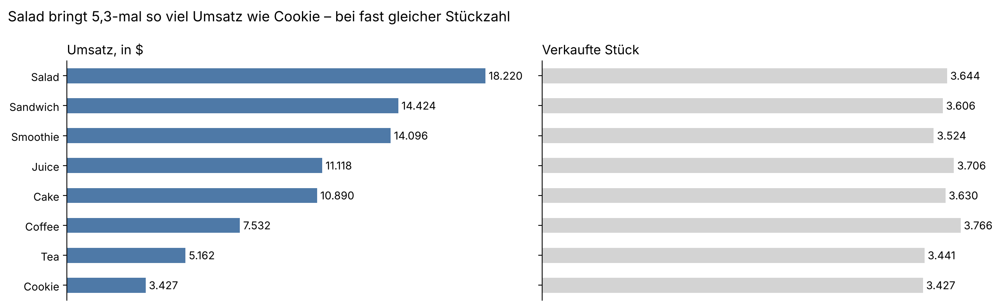
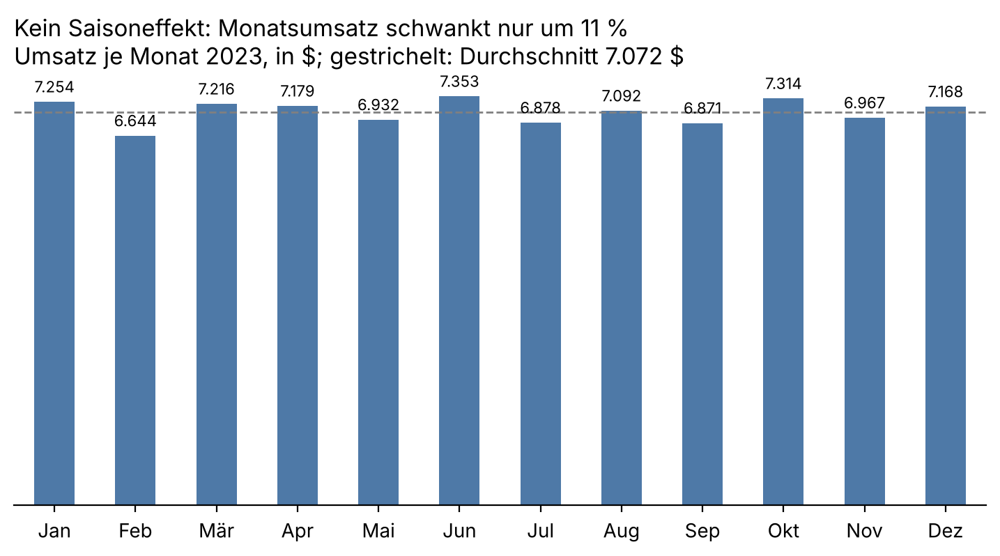
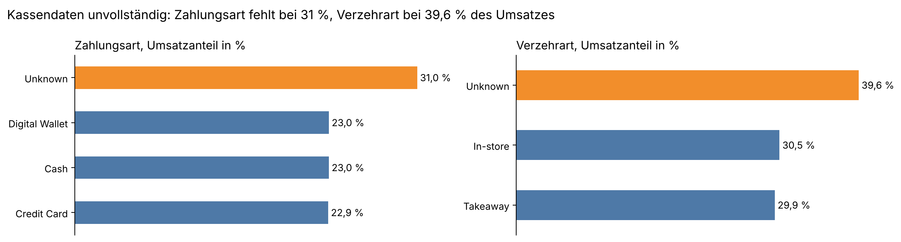
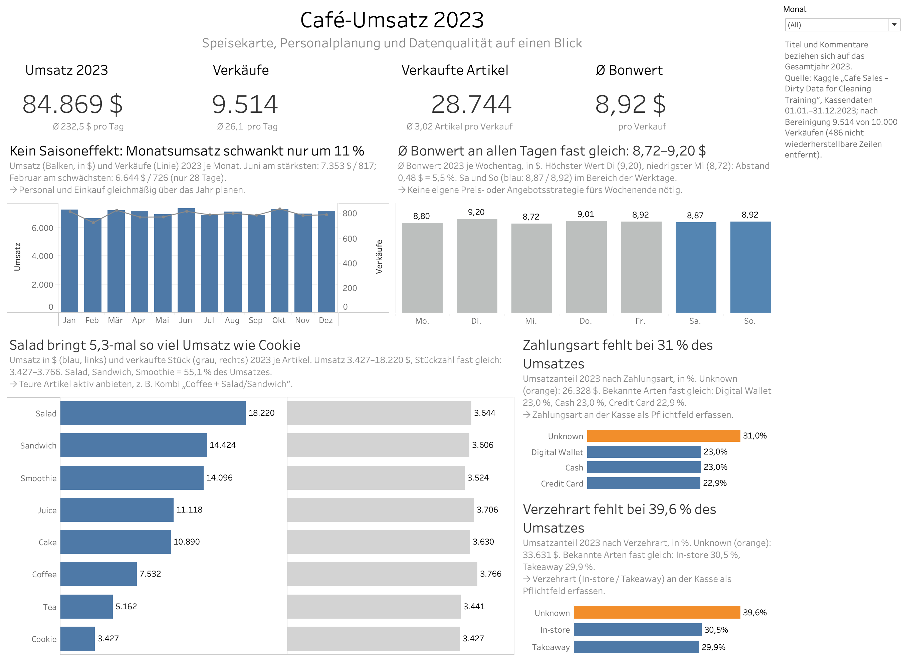

[🇬🇧 English](README.md) · 🇩🇪 Deutsch

# Café-Umsatz 2023: Datenbereinigung, EDA und Tableau-Dashboard

**Umsatz 84.868,50 $ · 9.514 Verkäufe · Ø Bonwert 8,92 $ · der Preis, nicht die Beliebtheit, treibt den Umsatz · 31–40 % der Kassendaten unvollständig**

## 1. Ausgangslage und Leitfragen

Ein Café-Inhaber stellt eine Verkaufsdatei für 2023 bereit, die absichtlich „verschmutzt“ ist: Lücken sowie die Wörter `ERROR` / `UNKNOWN` statt Werten. Aufgabe: die Daten bereinigen, explorativ analysieren und drei Geschäftsfragen beantworten:

1. **Speisekarte:** Welche Artikel treiben den Umsatz?
2. **Personalplanung:** Gibt es eine Saisonalität nach Monat oder Wochentag?
3. **Datenqualität:** Wie zuverlässig sind die an der Kasse erfassten Daten?

## 2. Links

| Was | Link |
|---|---|
| Interaktives Dashboard (Tableau Public, Deutsch) | [Café-Umsatz 2023](TABLEAU_PUBLIC_LINK) |
| Notebook: Bereinigung + EDA | [notebooks/cafe_sales_analysis.ipynb](notebooks/cafe_sales_analysis.ipynb) |
| Datensatz (Kaggle) | [Cafe Sales – Dirty Data for Cleaning Training](https://www.kaggle.com/datasets/ahmedmohamed2003/cafe-sales-dirty-data-for-cleaning-training) |

## 3. Daten und Werkzeuge

- **Daten:** 10.000 synthetische Café-Verkäufe aus 2023, 8 Spalten (Artikel, Menge, Preis, Summe, Zahlungsart, Verzehrart, Datum).
- **Python (pandas, NumPy, Matplotlib), Google Colab:** Bereinigung und explorative Analyse.
- **Tableau Public:** Dashboard mit Kennzahlen, Verlauf, Artikelmix und Datenqualität; Filter nach Monat.

**Bereinigung in Kürze:** Zahlen exakt wiederherstellen über *Summe = Menge × Preis* und feste Menüpreise → Artikel über einen eindeutigen Preis wiederherstellen → mehrdeutige Artikel (3,00 $ Cake/Juice, 4,00 $ Sandwich/Smoothie) anteilig füllen und markieren (`item_guessed`) → fehlende Zahlungsart und Verzehrart als `Unknown` kennzeichnen → 486 nicht wiederherstellbare Zeilen entfernen (4,9 %).

## 4. Antworten auf die Leitfragen

**Speisekarte.** Alle Artikel werden in fast gleicher Menge verkauft (3.427–3.766 Stück), der Umsatz unterscheidet sich aber um das 5,3-Fache zwischen Salad (18.220 $) und Cookie (3.427 $). Salad, Sandwich und Smoothie bringen 55,1 % des Umsatzes. Coffee ist Nr. 1 nach Stückzahl (3.766), aber nur Nr. 6 nach Umsatz (7.532 $).



**Personalplanung.** Keine Saisonalität: Der Monatsumsatz liegt zwischen 6.644 $ (Februar, 28 Tage) und 7.353 $ (Juni), ein Abstand von 10,7 %. Der Ø Bonwert ist an allen Wochentagen fast gleich (8,72–9,20 $); am Wochenende liegt er im Bereich der Werktage.



**Datenqualität.** Bei 31,0 % des Umsatzes fehlt die Zahlungsart, bei 39,6 % die Verzehrart (vor Ort / zum Mitnehmen). Unter den bekannten Werten sind die Anteile fast gleich (Bar / Kreditkarte / Digital Wallet je ≈ 23 %; In-store / Takeaway 50,5 / 49,5 %).



## 5. Empfehlungen für den Inhaber

1. **Teurere Artikel aktiv anbieten** (Salad, Sandwich, Smoothie), z. B. als Kombi „Kaffee + Salat/Sandwich“, statt Rabatte auf günstige Artikel.
2. **Personal und Einkauf gleichmäßig** über das Jahr planen: Es gibt keine Spitzen nach Monat oder Wochentag.
3. **Zahlungsart und Verzehrart an der Kasse als Pflichtfeld erfassen.** Ohne sie lassen sich Entscheidungen zu Kartenterminals oder Sitzplätzen nicht datenbasiert treffen.

## 6. Dashboard



Das Dashboard ist auf Deutsch (Zielmarkt Deutschland) und folgt dem Reporting-Standard IBCS: Titel nennen die Kernaussage, eine Farbe = eine Bedeutung (Orange = Handlungsbedarf). Titel und Kommentare beziehen sich auf das Gesamtjahr 2023; der Monatsfilter ändert die Grafiken, nicht die Texte.

## 7. Grenzen der Daten und nächste Schritte

- Synthetischer Übungsdatensatz: Muster (z. B. gleich häufige Mengen 1–5 pro Kauf) sind für ein echtes Café untypisch.
- 486 Zeilen (4,9 %) als nicht wiederherstellbar entfernt; 450 Artikel in den bereinigten Daten wurden anteilig geschätzt. Ohne die geschätzten Zeilen ändert sich die Reihenfolge der Artikel nicht.
- Aussagen zu Zahlungsart und Verzehrart sind wegen des hohen Anteils `Unknown` nur Richtwerte.
- Nächste Schritte mit echten Daten: Uhrzeit (Stoßzeiten), Kunden-IDs (Wiederkäufe), Marge je Artikel statt Umsatz.

## 8. Projektstruktur

```
├── README.md / README.de.md
├── requirements.txt
├── Data/
│   ├── dirty_cafe_sales.csv      Rohdaten (Kaggle)
│   └── cafe_sales_clean.csv      bereinigte Daten, Quelle für Tableau
├── notebooks/
│   └── cafe_sales_analysis.ipynb Bereinigung + EDA
├── tableau/
│   └── cafe_dashboard.twbx       Tableau-Arbeitsmappe
└── images/                       Grafiken und Dashboard-Screenshot für dieses README
```

## 9. Autor

Sergii Vdovenkov · Data Analytics & Engineering (Deutsche Tech Akademie) · [GitHub](https://github.com/SergiiVdovenkov)
