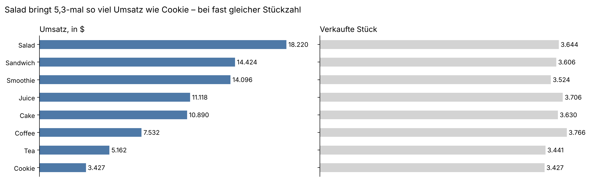
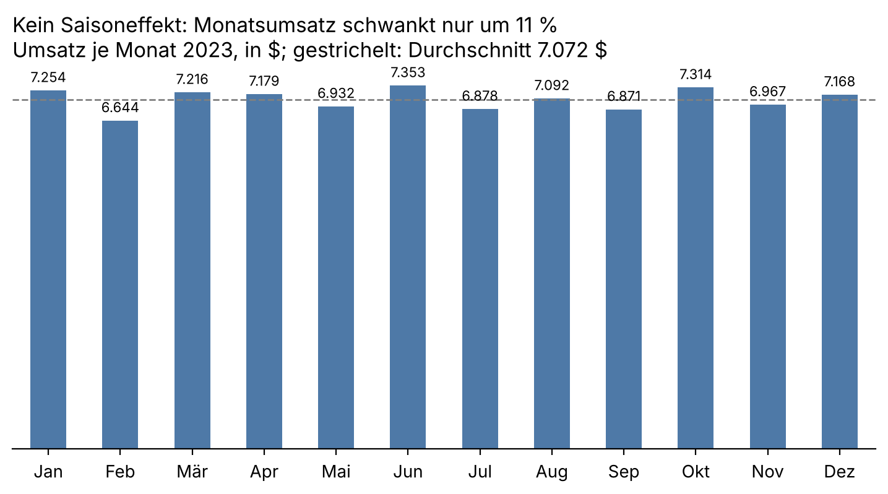
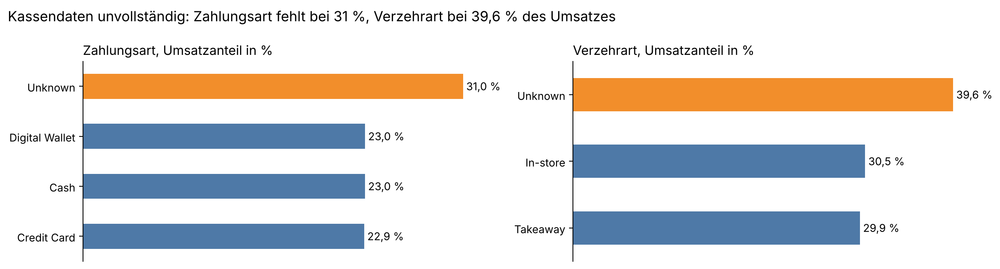
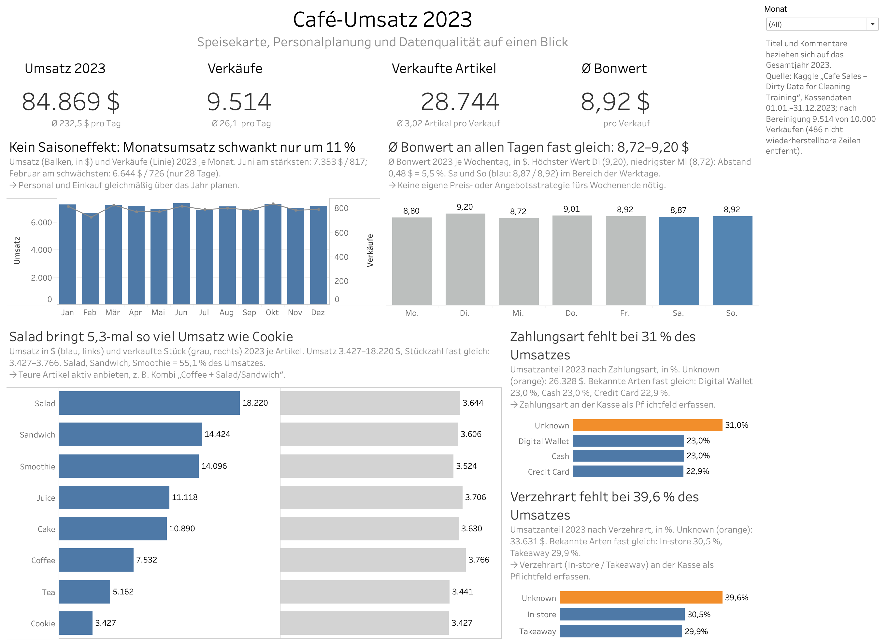

🇬🇧 English · [🇩🇪 Deutsch](README.de.md)

# Café Sales 2023: Data Cleaning, EDA and Tableau Dashboard

**Revenue $84,868.50 · 9,514 transactions · average check $8.92 · price, not popularity, drives revenue · 31–40 % of till data incomplete**

## 1. Background and key questions

A café owner provides a sales file for 2023 that is deliberately "dirty": gaps, and the words `ERROR` / `UNKNOWN` instead of values. The task is to clean the data, explore it and answer three business questions:

1. **Menu:** which items drive revenue?
2. **Staff planning:** is there seasonality by month or weekday?
3. **Data quality:** how reliable is the data recorded at the till?

## 2. Links

| What | Link |
|---|---|
| Interactive dashboard (Tableau Public, German) | [Café-Umsatz 2023](TABLEAU_PUBLIC_LINK) |
| Notebook: cleaning + EDA | [notebooks/cafe_sales_analysis.ipynb](notebooks/cafe_sales_analysis.ipynb) |
| Dataset (Kaggle) | [Cafe Sales – Dirty Data for Cleaning Training](https://www.kaggle.com/datasets/ahmedmohamed2003/cafe-sales-dirty-data-for-cleaning-training) |

## 3. Data and tools

- **Data:** 10,000 synthetic café transactions in 2023, 8 columns (item, quantity, price, total, payment method, location, date).
- **Python (pandas, NumPy, Matplotlib), Google Colab:** cleaning and exploratory analysis.
- **Tableau Public:** dashboard with KPIs, trends, item mix and data quality; filter by month.

**Cleaning in short:** restore numbers exactly via *total = quantity × price* and fixed menu prices → restore the item from a unique price → fill ambiguous items ($3.00 Cake/Juice, $4.00 Sandwich/Smoothie) proportionally and flag them (`item_guessed`) → mark missing payment method and location as `Unknown` → remove 486 rows that cannot be restored (4.9 %).

## 4. Answers to the questions

**Menu.** All items sell in almost the same quantities (3,427–3,766 units), but revenue differs 5.3× between Salad ($18,220) and Cookie ($3,427). Salad, Sandwich and Smoothie bring 55.1 % of revenue. Coffee is #1 by units (3,766) but #6 by revenue ($7,532).



**Staff planning.** No seasonality: monthly revenue ranges from $6,644 (February, 28 days) to $7,353 (June), a 10.7 % gap. The average check is almost equal on all weekdays ($8.72–9.20); weekend checks are within the weekday range.



**Data quality.** The payment method is missing for 31.0 % of revenue and the location (in-store / takeaway) for 39.6 %. Among known values the shares are almost equal (cash / credit card / digital wallet ≈ 23 % each; in-store / takeaway 50.5 / 49.5 %).



## 5. Recommendations for the owner

1. **Promote higher-priced items** (Salad, Sandwich, Smoothie), e.g. a "coffee + salad/sandwich" combo, instead of discounts on cheap items.
2. **Plan staff and purchasing evenly** over the year: there are no peaks by month or weekday.
3. **Make payment method and location mandatory at the till.** Without them, decisions on payment terminals or seating cannot be based on data.

## 6. Dashboard



The dashboard is in German (target market Germany) and follows the IBCS reporting standard: titles state the key message, one colour = one meaning (orange = needs action). Titles and comments refer to the full year 2023; the month filter changes the charts, not the texts.

## 7. Data limitations and next steps

- Synthetic training dataset: patterns (e.g. equal quantities 1–5 per purchase) are not typical for a real café.
- 486 rows (4.9 %) removed as not restorable; 450 items in the clean data were guessed proportionally. The item ranking does not change without the guessed rows.
- Conclusions on payment method and location are indicative because of the high share of `Unknown`.
- Next steps with real data: time of day (peak hours), customer IDs (repeat visits), margins per item instead of revenue.

## 8. Project structure

```
├── README.md / README.de.md
├── requirements.txt
├── Data/
│   ├── dirty_cafe_sales.csv      raw data (Kaggle)
│   └── cafe_sales_clean.csv      cleaned data, source for Tableau
├── notebooks/
│   └── cafe_sales_analysis.ipynb cleaning + EDA
├── tableau/
│   └── cafe_dashboard.twbx       Tableau workbook
└── images/                       charts and dashboard screenshot for this README
```

## 9. Author

Sergii Vdovenkov · Data Analytics & Engineering (Deutsche Tech Akademie) · [GitHub](https://github.com/SergiiVdovenkov)
